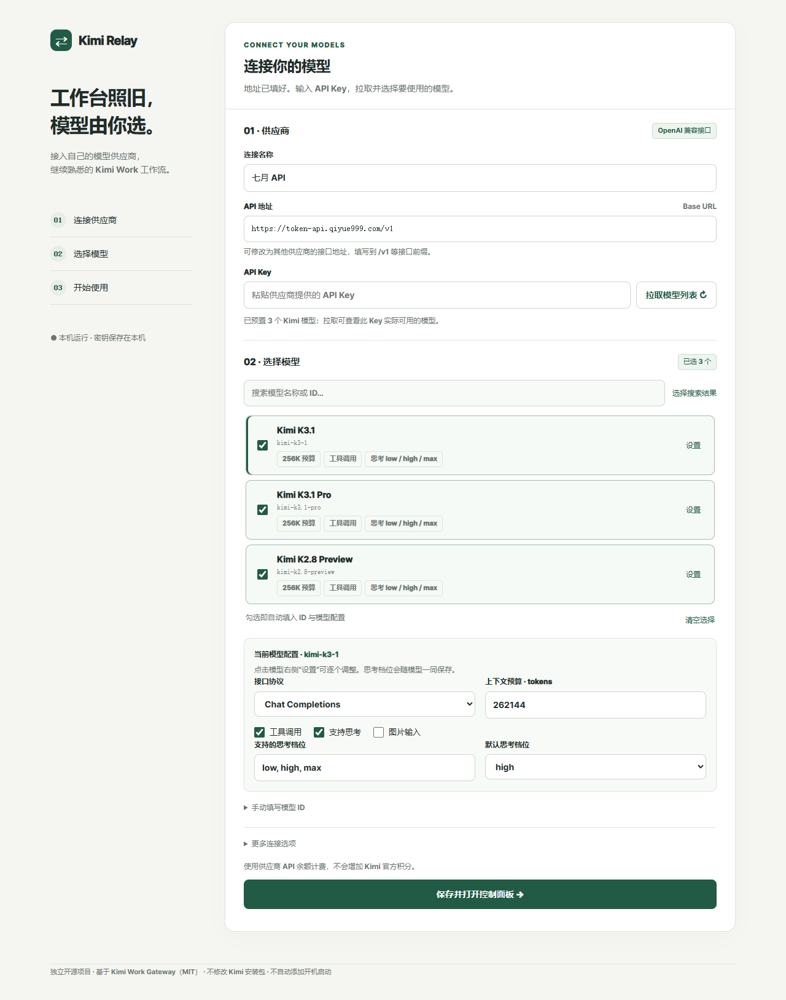

# Kimi Relay · Kimi 接力

[English](README.en.md) · [下载预览版](https://github.com/miboyule/kimi-relay/releases) · [客户答复 / Customer replies](docs/CUSTOMER-FAQ.md) · [改动与恢复 / Changes & recovery](docs/CHANGES-AND-RECOVERY.md)

让 Kimi Work 使用你自己的第三方模型供应商。**中转站余额是第三方 API 额度，不是 Kimi 官方积分；本工具不会给 Kimi 官方账户充值。**

基于 [Kimi Work Gateway](https://github.com/wssz527/kimi-work-gateway)（MIT）的桌面二次开发。复用其网关、原生模型导入和面板，增加随包运行环境、首次设置、运行管理、备份和旧配置迁移。上游版本与版权完整保留在 [vendor/UPSTREAM.json](vendor/UPSTREAM.json) 和 [第三方声明](THIRD_PARTY_NOTICES.md)。与 Kimi / Moonshot 官方无隶属关系。

**推荐使用 Lite 轻量版：** 去掉内置浏览器，完整包低于 50 MB；后续可只下载约 0.51 MB 的代码包，替换 Relay 自己的文件。旧版 Electron 包仍保留在历史发布中。详见 [轻量版与文件替换，中英双语](docs/LITE.md)。



beta.7 支持默认七月 API 地址、在线拉取与搜索勾选模型，以及逐模型保存思考档位。详见 [模型选择说明（中英）](docs/MODEL-PICKER.md)。

## 三步使用

1. 从 Releases 下载对应系统的 zip，解压整个文件夹。Windows 双击 `Start Kimi Relay.vbs`（备用 `.cmd`）；macOS 双击 `Kimi Relay Lite.app`（备用 `.command`）。保留整个解压文件夹，不要单独移动 `.app`。默认浏览器打开管理页。无需安装 Node.js、npm 或修改脚本执行策略。
2. 点击设置入口，默认已填七月 API 地址和三个 Kimi 模型。输入 **API Key**，点击“拉取模型列表”，搜索并勾选即可自动填写 ID 与能力；可改用其他地址或手动添加。三个默认模型使用 256K 预算，思考档位为 low / high / max、默认 high；未知模型从 32K 预算起配置。保存后进入完整控制面板。
3. 在控制面板完成 Kimi 接入，在 Kimi Work 输入框旁选择导入的模型。保持 Relay 运行；关闭网页会继续运行，管理页“停止并退出”才会关闭网关。再次双击启动文件可重新打开管理页。

若显示需要单域名解析，请从管理页进入“修改接入”（旧桌面版：应用菜单的首次设置），展开“更多连接选项”并勾选后保存。Windows 使用一组带标记的 hosts 条目；macOS 使用单域名 resolver。系统会请求管理员授权。默认不会执行此项。

新连接或 API Key 变动可能需要从管理页“重启网关”；界面中上游原有的终端命令提示可用这个菜单替代。重启前请结束正在进行的 Work 任务。

## 改了什么

| 项目 | 行为 |
|---|---|
| Kimi 安装目录、`app.asar`、可执行文件、签名 | 不修改、不重新分发 |
| Kimi 用户配置 | 原生接入会写模型网关、目录和可见性设置；接入前备份主配置与两份 runtime TOML |
| Relay 自身目录 | 保存连接、单独的凭据文件、运行状态、备份 |
| 系统文件 | 默认不修改；明确启用时才写单域名解析，可从菜单撤销 |
| 后台服务和开机启动 | 不自动安装，Lite 在后台运行本机网关，不依赖网页保持打开 |
| 官方积分、账号、会员、官方工具服务 | 不充值、不替换、不解锁；仍由 Kimi 管理 |

原生接入使用上游的**私有本机调试管道**调用 Kimi 的导入接口，无公开调试端口。若需要接管启动，可能要求 Kimi 空闲或先退出再打开；不是对未来版本“永久无感”的保证。

## 支持与验证

- Windows x64；macOS Apple Silicon / Intel。发布流程分别在原生 GitHub runner 构建和运行启动脚本、隔离浏览器与网关检查；完整包严格限制在 50,000,000 字节以下。
- 协议支持 OpenAI Chat Completions 与 Responses，不转换原生 Anthropic Messages，也不把 Chat-only 服务伪装为 Responses。每个模型可用不同本地路由 ID，真实上游 ID 会保留。
- Kimi Work 3.2.27 Windows 已通过真实安装包解析器检查：5 个样例被接受，0 个丢弃。HTTP / SSE / Responses 转发通过本地模拟上游验证。
- **这些检查不等于登录账号后的真实付费推理已验收。** 预览版先用自己的一个测试会话确认模型菜单、工具调用和中转站账单中的请求记录。模型本身需支持 Work 所需工具；Kimi 的搜索、媒体、记忆等独立服务仍可能依赖官方账号与权益。
- 发行包目前未配置发布者代码签名与 Apple 公证。操作系统可能要求用户确认来源。

## 数据与便携模式

默认从管理页“更多选项 → 打开数据目录”查看真实位置。通常为 Windows `%APPDATA%/Kimi Relay/gateway`，macOS `~/Library/Application Support/Kimi Relay/gateway`。以软件实际打开的目录为准。

**Lite 使用 `KIMI_RELAY_HOME` 指定便携数据目录；默认复用旧版数据。升级与复用旧运行环境见 [Lite 说明](docs/LITE.md)。** 以下标记仅用于旧 Electron 版：Windows 在 exe 同级创建一个名为 `portable-mode` 的空文件，网关配置和凭据使用同级 `portable-data/`；桌面缓存仍在系统用户数据目录。macOS 或高级用户可通过 `KIMI_RELAY_HOME` 指定独立目录，网关与桌面缓存一起放入该目录。Kimi 自身数据仍留在 Kimi 原有目录。

凭据文件可由当前系统用户读取，未额外使用系统钥匙串加密；分享配置时只导出不含密钥的 `gateway.json`，不要分享整个数据目录、备份或带 `#key=` 的面板链接。

## 从旧脚本迁移

针对 `service.js` / `mapping.json` 这类固定转发脚本提供狭义迁移器。它静态读取常量，**不执行旧脚本**；先备份原文件，再把地址、Key、映射导入 Relay 独立目录。不修改原配置，不停止旧进程，不删除开机项；接入新网关前请结束旧代理及其自动重写任务。

```powershell
# 源码用户：默认只检查；确认结果后加 --apply 执行备份与导入
node scripts/migrate.mjs --config "C:\path\to\Kimi\config.json" --proxy-dir "C:\path\to\old-proxy" --state-dir "C:\path\to\Relay\gateway"
```

不符合已识别结构的脚本会拒绝自动迁移，可直接使用首次设置。现有多连接 / 混合协议配置通过完整控制面板管理，首次设置页不会覆盖它们。

## 开发与维护

```sh
npm ci
npm run check
npm test
npm run runtime
npm start
npm run build:lite  # 当前平台轻量 ZIP；无需安装 Electron
npm run smoke:lite  # 检查实际轻量包
npm run build:win   # 可选：旧 Electron 版，Windows 主机
npm run build:mac   # 可选：旧 Electron 版，macOS 主机；分别原生构建 arm64 / x64
npm run smoke      # 检查已打包的应用
```

运行时从 Node 官方固定版本下载，核对官方 SHA256 后打包。`v*` 标签触发双平台 Lite 构建和预发布；发布说明附校验值。不会自动替换正在运行的安装。维护方向见 [路线图](docs/ROADMAP.md)。

MIT。衍生项目允许商业使用；保留本项目和上游许可。反馈问题请提供系统、Kimi 版本、Relay 版本、错误代码和脱敏复现步骤，不要提交 Key、登录令牌或备份。
