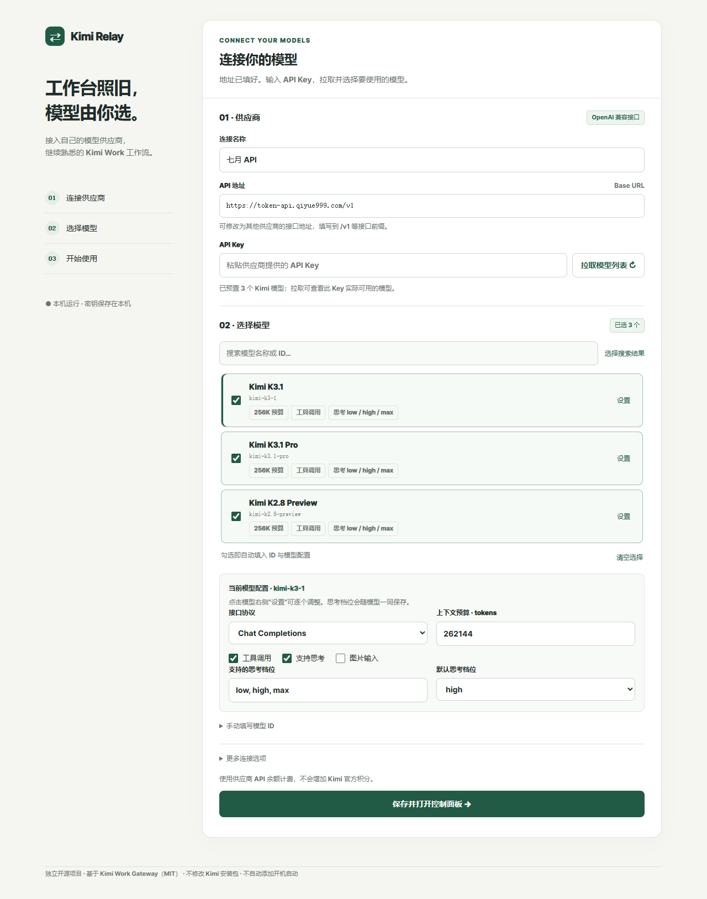
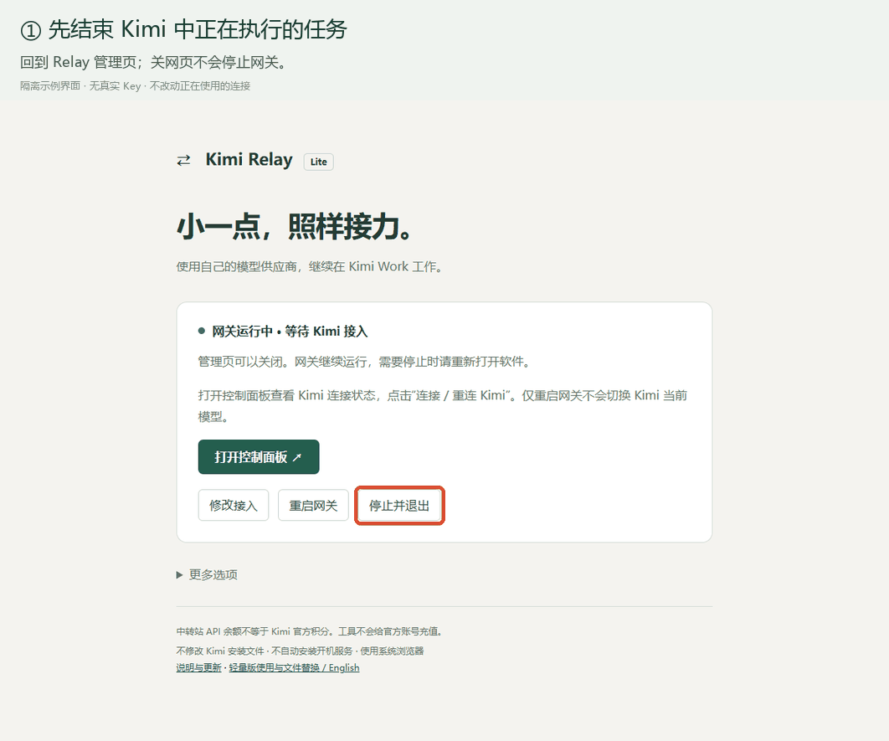
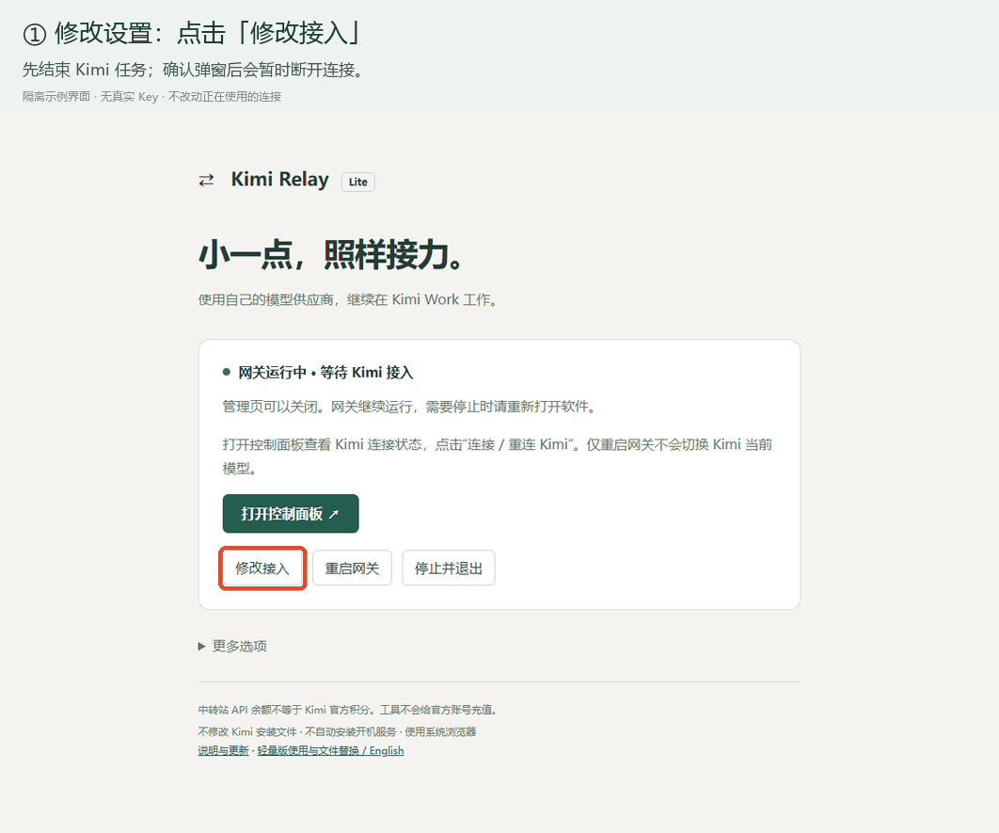
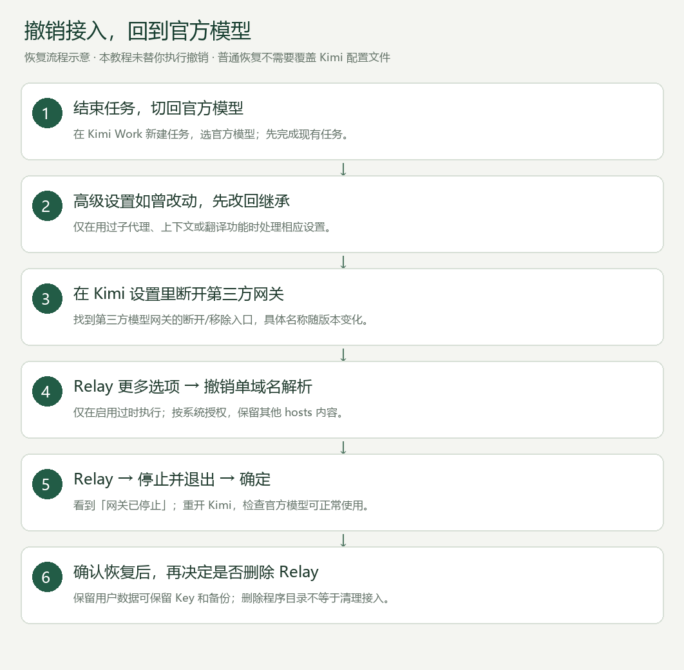
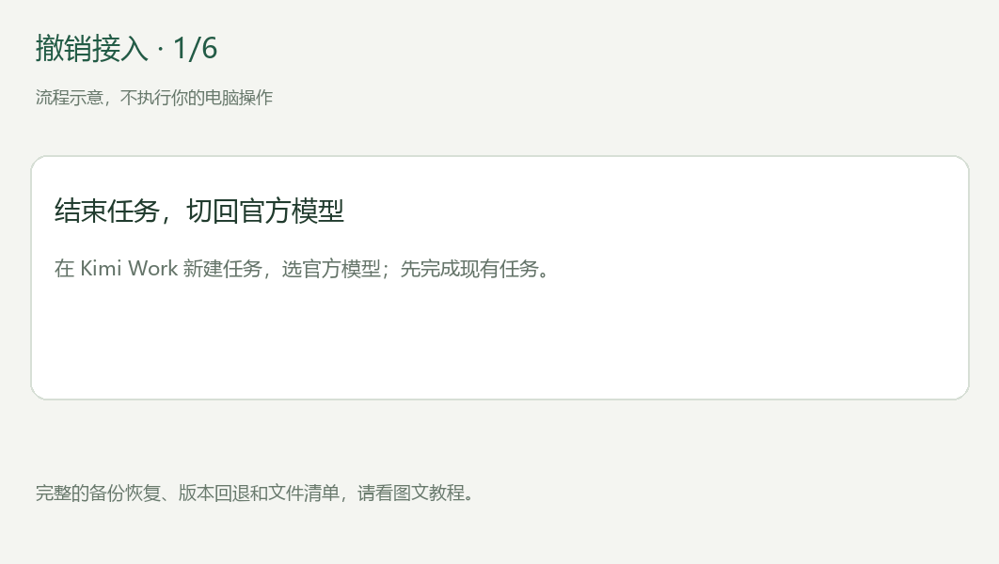

# Kimi Relay 详细图文教程：使用、停止、修改与恢复

适用：**Kimi Relay Lite beta.7**。Windows 为主，附 Mac 对应操作。截图、动图以此版本为准。更新时间：2026-11-19。

> 第一次只需要走通：启动 Relay → 保存供应商 → 连接 Kimi → 在 Kimi Work 新任务里选择第三方模型。以后日常使用只需要启动 Relay 和 Kimi。

## 先分清三个窗口

| 你看到的窗口 | 用来做什么 | 最常用的按钮 |
|---|---|---|
| Relay 管理页：标题“小一点，照样接力” | 启动后看的首页，管理整个程序 | 打开控制面板、修改接入、重启网关、停止并退出 |
| Relay 供应商设置页：标题“连接你的模型” | 填网址、Key，拉取并勾选模型 | 拉取模型列表、模型右侧的设置、保存并打开控制面板 |
| Relay 控制面板：左侧有概览、模型管理、连接与工具 | 查看接入、模型和实际请求情况 | 连接与工具 → Kimi 接入 → 重新接入 Kimi |

**真正提问和做任务，始终在 Kimi 桌面客户端的 Work 里。** Relay 是让 Kimi 连接你的供应商的工具。只保存供应商设置不会切换 Kimi 正在使用的模型。

## 1. 怎么启动

### Windows

1. 完整解压对应 Windows 完整包，保留 `app/`、`runtime/` 和启动文件在同一目录。
2. 双击 **`Start Kimi Relay.vbs`**。这是日常启动入口。
3. 浏览器打开 Relay 管理页。使用浏览器是正常的，网关在本机运行。
4. 如果系统禁用了 VBS，改双击 **`Start Kimi Relay.cmd`**。
5. 看到“等待填写供应商”时，点击绿色的填写供应商入口；已经保存过则点击“打开控制面板”。

**不要单独运行 `runtime/node.exe`；不要只把一个启动文件拖到桌面。** 想放桌面图标，可为 `Start Kimi Relay.vbs` 创建快捷方式，整个程序目录保持完整。

### Mac

完整解压对应 `mac-arm64`（Apple Silicon）或 `mac-x64`（Intel）包，双击 **`Kimi Relay Lite.app`**。保留旁边的 `app/`、`runtime/`，不要只移动小的 `.app`。备用入口是 `Start Kimi Relay.command`。设置与停止按钮和 Windows 一样。

## 2. 第一次填什么

已有配置的用户可以直接看第 3 节；不用为了使用再填一遍 Key。

| 项目 | 七月 API 的填写方法 | 什么时候需要改 |
|---|---|---|
| 连接名称 | 默认“七月 API”即可，只是显示名称 | 想改成方便自己识别的名称 |
| API 地址 | `https://token-api.qiyue999.com/v1` | 换了供应商或服务商通知更换地址 |
| API Key | 粘贴供应商给你的 API 密钥 | 新用户填写，换 Key 时替换 |
| 模型 | 默认三个 Kimi 模型，可拉取后勾选 | 添加或移除可用模型 |
| 协议 | 这三个默认模型使用 Chat Completions | 供应商明确要求 Responses 时 |
| 本机端口 | 默认 3426 | 提示端口被占用时才考虑更换 |

操作顺序：

1. 确认地址，粘贴你自己的 **API Key**。
2. 点击 **“拉取模型列表”**，等待出现“已拉取 ×× 个模型”。
3. 搜索 `kimi`，勾选需要的模型。模型 ID 会自动填入，不需要手抄。
4. 三个默认模型是 `kimi-k3-1`、`kimi-k3.1-pro`、`kimi-k2.8-preview`。预置不代表某个 Key 一定有权限，实际权限以供应商为准。
5. 点击 **“保存并打开控制面板”**，等待跳转。

每个模型右侧的“设置”用于单独调整能力。三个预置模型已带入工具调用、256K 上下文预算，以及 `low / high / max` 思考档位、默认 `high`。256K 是本工具的保守使用预算，不是对供应商最大上下文的承诺。图片能力默认没开启。

**新添加的未知模型不一定已声明工具、思考或图片能力。** 以供应商的模型说明为准，不能只根据名称勾选所有功能。

API Key 是 API 密钥，不是账号密码，也不是 Kimi 官方积分充值码。保存后 Key 输入框为空是正常的，表示不会回显；同一已保存连接留空可沿用。

## 3. 保存后，怎么让 Kimi 真正接上

这是最容易漏掉的一步。

1. 打开官方 **Kimi 桌面客户端**并登录，进入 Work。
2. 回到 Relay 管理页，点击 **“打开控制面板”**。
3. 控制面板左侧点击 **“连接与工具”**。
4. 向下找到 **“Kimi 接入”**，点击 **“重新接入 Kimi”**。有些状态提示可能称“连接 / 重连 Kimi”，以你看到的按钮为准。
5. 等待状态更新。**“正在等待上一次接入完成”表示仍在等待，不能当作完成。** 不要连续反复点击。

如果页面明确提示要启用单域名解析：

1. 回管理页点击“修改接入”。找不到管理页时，再双击启动文件打开。
2. 在供应商设置页展开 **“更多连接选项”**。
3. 勾选 **“允许配置 Kimi 所需的单域名解析”**，保存。
4. 回控制面板连接 Kimi，出现系统授权时按提示完成。

这个解析选项是为了让 Kimi 识别第三方网关，不是修改你的供应商网址。没有提示且接入正常时，不需要重复操作。撤销方式见第 9 节。

如果一直提示等待 Kimi 退出或等待空闲：先结束 Kimi 任务。Windows 右上角的 × 可能只是缩到托盘；从右下角 Kimi 托盘菜单**完全退出 Kimi**，再回 Relay 控制面板点击“启动 Kimi”并重新接入。Mac 可从 Kimi 菜单退出或使用 Command-Q。不要用强制结束进程来代替正常退出。

界面有子代理、思考翻译、MCP 等很多设置，第一次接入可以先保持原值，不需要逐个配置。

## 4. 在 Kimi 里选哪个模型，怎么确认成功

1. 打开 Kimi 桌面客户端的 **Work**。
2. **新建任务**，先用新任务验证，避免旧任务保存的模型影响判断。
3. 点击输入框附近 / 下方的模型按钮，找到 **“第三方网关”**或导入的供应商模型分组。
4. 选择添加的真实模型，例如 **`kimi-k3-1`**。有些界面会显示本地别名，可能带 `relay/`、`byok-kth-kimi/` 或重复的 `kimi-` 前缀；这是路由别名，不用手动改成官方模型 ID。
5. 发送：**“只回复：连接成功”**。
6. 回 Relay 控制面板 → **“概览”**，查看最近请求表，确认刚才的时间、模型和成功状态；再到供应商后台确认对应请求记录。

**同时满足“选了第三方模型、收到回答、请求记录正确”才算完成一次实际使用验证。** “网关运行中”只说明 Relay 开着；“模型已导入”只说明菜单目录已接入。列表里的官方 `K3` 或 `K3.1 Pro` 仍可能是官方服务，不能仅凭相似名称认定走了中转。

日常使用：先启动 Relay → 打开 Kimi → 在 Work 选第三方模型 → 使用。浏览器管理页可以关掉。电脑重启后需要再次启动 Relay，这一版不自动开机启动，也没有 Lite 托盘图标。

## 5. 怎么停止：最常用的三个按钮

| 操作 | 会发生什么 | 适合什么时候 |
|---|---|---|
| 关闭网页 | 网关继续运行 | 不想一直看管理页 |
| 重启网关 | 暂时断开，随后重新启动 | 应用某些连接修改或处理暂时故障 |
| 停止并退出 | 关闭 Relay 网关 | 暂时不用、要更新或回退版本 |

### 停止的完整步骤

1. 先结束 Kimi 正在执行的任务；准备继续用官方模型的话，先切回官方模型。
2. 回 Relay 管理页。网页关了就再次双击 `Start Kimi Relay.vbs`，它会重新打开管理页。
3. 点击 **“停止并退出”**。
4. 弹窗提醒会中断第三方模型连接，点击 **“确定”**。
5. 看到 **“网关已停止”**，就停好了，可以关网页。

停止会保留网址、Key、模型和备份。它不等于撤销 Kimi 中已经导入的模型，也不会删除解析条目。停用后如果仍选着第三方模型发消息，会因本机网关不在运行而失败。

### 下次怎么恢复运行

双击 `Start Kimi Relay.vbs` → 等待网关运行 → 打开 Kimi Work，选择第三方模型。通常无需重新填 Key；如果接入状态需要恢复，再到控制面板重新接入。

## 6. 怎么修改网址、Key、模型和思考档位

### 共同入口

1. 结束当前 Kimi 任务。
2. Relay 管理页点击 **“修改接入”**。
3. 在确认弹窗点确定。此时会暂时断开第三方连接，然后打开供应商设置。
4. 修改后点击 **“保存并打开控制面板”**。
5. 按界面提示重新接入 Kimi；新建一个 Work 任务验证。

动图使用独立的本机示例服务、示例 Key 录制。正式七月 API 的地址应保持 `https://token-api.qiyue999.com/v1`，不要照抄演示里的 `127.0.0.1` 供应商地址。

### 只换 Key

网址不变，将新 Key 粘贴进输入框，保存。保存后不再回显；**空着保存表示保留旧 Key，不表示删除 Key**。用拉取列表和小测试确认新 Key 权限、余额正常。

### 换供应商网址

修改 API 地址，重新填写**新地址对应的 Key**，拉取并勾选模型，然后保存。更换地址会清空旧候选和选择，避免把旧模型误配给新供应商。旧 Key 不会自动发到新地址。

### 增删模型

地址不变 → 拉取 → 勾选要加的模型 / 取消不需要的模型 → 保存。在 Kimi 新任务里检查模型菜单。删除当前使用的模型前，先在 Kimi 切换到其他模型。拉取失败时可使用“手动填写模型 ID”，每行一个真实 ID。

### 开启或修改思考

1. 找到要改的模型，点击其右侧 **“设置”**。
2. 对供应商确认支持的默认三个模型，勾选 **“支持思考”**。
3. “支持的思考档位”填 **`low, high, max`**。
4. “默认思考档位”选 **`high`**，保存。
5. 接入 Kimi 后在新任务中选择该模型和相应档位。

`Supported efforts: off` 说明 Kimi 当前读到的模型能力仍只支持 off，不能靠单独把全局档位调 high 解决。要先正确保存模型能力并同步到 Kimi，再选择档位。已有任务可能单独保存了旧设置。其他供应商的档位不一定相同，不要照搬三个 Kimi 预设。

New API 一般不需要为了这个本地能力错误添加特殊设置。真实思考参数透传和返回字段说明见 [思考与 New API](REASONING-AND-NEWAPI.md)。

## 7. 修改错了，怎么撤销刚才的设置

### 还没有保存

**网页刷新不是可靠的撤销方式**：当前页可能需要从启动入口重新获取管理会话。最稳妥的做法：再次双击启动文件 → 回管理页点 **“重启网关”**，让它按上一次保存的配置重新运行。第一次从未保存过的用户，重新打开设置再填即可。

### 已经保存，但还记得正确值

回“修改接入”，把错误的地址、模型选择或档位改回正确值，再保存。只是改显示名称的话，不影响请求地址。错误 Key 需要重新填正确 Key，留空只会保留刚才保存的那个 Key。

### 已保存，想恢复到修改前的 Relay 设置

每次设置页覆盖已有配置前，Relay 会把旧文件存入自己的数据目录 `backups/`。这会恢复 Relay 的供应商设置，不等于撤销 Kimi 接入。

1. 管理页 → 更多选项 → **“打开数据目录”**，先把这个目录位置记下。
2. 管理页 → **“停止并退出”**，确认网关已停止。
3. 另外复制当前 `gateway.json`、`credentials.json`、`setup-receipt.json` 到一个新备份文件夹。
4. 在 `backups/` 里找到**误修改发生前**那一次备份，打开 `manifest.json`。其中 `source` 是原路径，`name` 是这次备份中的文件名；备份名可能带序号。
5. 将同一次备份中这三个文件复制回各自 `source` 路径，以原文件名覆盖。不要把带序号的备份文件直接丢进去却不改名，也不要把不同时间的配置与 Key 混用。
6. 重新启动 Relay，确认地址、模型，必要时重新接入 Kimi。

如果那次备份缺少其中某个文件，先确认当时是否尚未创建；不要从其他软件目录随便补一份。备份中含 Key，保存在自己电脑上即可。

## 8. 软件更新后不好用，怎么回退旧版本

这是**恢复 Relay 软件版本**，不是恢复官方模型，也不是恢复供应商设置。

1. 结束 Kimi 任务，管理页“停止并退出”。
2. 将当前 Relay 程序目录复制一份保存。
3. 从升级前的程序备份恢复 **`app/`、启动文件、`VERSION.json`、对应说明文件**。要精确回退，先把当前 `app/` 移到别的备份位置，再复制旧的 `app/`，避免混用两个版本的文件。
4. **保留 `runtime/` 和用户数据。** 若版本说明要求更换运行环境，使用该旧版本完整包，勿混配运行环境。
5. 重新双击启动文件，验证。供应商设置和 Key 默认在用户数据目录，不会随程序回退自动回退。

后续更新正好相反：停止 → 备份 → 把 code-only ZIP 解压覆盖到 **Relay 自己的目录** → 重开。首次使用要完整包，代码更新包不带运行环境。任何 Relay ZIP 都不要解压到 Kimi 安装目录。

## 9. 不想用了：撤销接入，回到官方模型

### A. 只是临时不用第三方

结束任务 → Kimi 新任务切回官方模型 → Relay“停止并退出”。这样保留已导入目录、解析设置、Key 和备份，下次还能启用。

### B. 撤销 Relay 接入，恢复官方使用

1. **结束当前任务，切回官方模型。** 后续官方调用按 Kimi 账号原来的规则使用。
2. 如果曾改过“子代理固定模型”“思考翻译”“自定义上下文整理”等高级选项，先在 Relay 相应页面改回继承 / 默认 / 关闭，并确认应用完成。未使用过则跳过。
3. 在 **Kimi 自己的设置**中找到第三方模型网关，用断开 / 移除接入入口断开。名称可能随 Kimi 版本变化；Relay 的“停止并退出”不能代替这个步骤。找不到入口时，先做到切回官方、停止 Relay，保留文件与备份，再按当前版本核对入口，不要删除整个 Kimi 用户目录。
4. **Relay 还在运行时**，在管理页展开 **“更多选项”**，点击 **“撤销单域名解析”**。确认弹窗，按系统提示完成授权；没有启用过解析则跳过。看到撤销完成提示后继续。
5. Relay 管理页点击 **“停止并退出”**，确认状态变为“网关已停止”。
6. 完全退出并重新打开 Kimi，使用新任务检查官方模型可正常使用；模型菜单中第三方接入是否清理，以 Kimi 的断开结果为准。
7. 确认不再使用后，可删除**Relay 程序文件夹**。保留用户数据即保留 Key 和备份；如要删除数据，也应先另外保存所需备份再操作。

撤销解析后，如果软件已停止但还没执行撤销，重新启动 Relay 打开管理页，再执行第 4、5 步。**不要直接清空系统 hosts 文件**，那里可能还有其他软件的设置。

### C. 要求文件精确回到某次备份

普通停用不需要做到这一步。精确恢复会影响 Kimi 用户配置，必须选对**接入前**同一次备份。

1. 先完成上面的断开、撤销解析，完全退出 Kimi 和 Relay，也停用旧的自动重写脚本。
2. 先完整备份当前待恢复文件。
3. 打开接入前那次 `manifest.json`，按 `source`、`name` 和 SHA-256 对应恢复，不要只看文件名猜。
4. 主配置 `config.json` 可能已刷新登录信息，旧备份可能含旧令牌。优先使用 Kimi 的断开和针对接入字段的恢复；整份复制只适合确实要回到那一时间点的情况，之后可能需要重新登录。
5. `byok-providers.json` 可能有其他供应商资料，不要直接删除整份；只有能确认归属和时间点的文件才恢复。备份中没记录的文件不代表可以随便删除。
6. 重开 Kimi 检查官方任务，再决定是否清理 Relay 数据。

精确到字节的旧配置、当前有效登录状态、保留后来新加的其他供应商，可能不能同时通过“整份覆盖”实现。需要保留后两项时，应按备份只撤销 Relay 的相关字段。

## 10. 到底改了哪些文件

这里区分“软件更新换的文件”“保存供应商写的文件”“接入 Kimi 涉及的文件”。不是列表中每一个文件在每次启动都会改变。

### Relay 软件本身

| 文件 / 目录 | 作用 | 怎么恢复 |
|---|---|---|
| 解压目录的 `app/` | Relay 的页面、程序和上游网关代码 | 停止后恢复升级前的整个 app/ |
| `Start Kimi Relay.vbs`、`.cmd`、`.command`、`Kimi Relay Lite.app` | 各系统启动入口 | 用同版发行包或备份恢复 |
| `VERSION.json`、README 和说明文件 | 版本与使用说明 | 随程序版本一起恢复 |
| `runtime/` | 随包 Node 运行环境 | beta.7 代码更新保留，完整包包含 |

beta.7 的主要源码变化是 `ui/setup.html`（模型选择页）、`src/setup-discovery.mjs`（读取供应商模型列表）、`src/worker.mjs`（接上新页面能力）、打包脚本、测试与说明。没有新增需要客户安装的依赖。

### Relay 私人数据

Windows 默认 `%APPDATA%\Kimi Relay\gateway\`。Mac 默认 `~/Library/Application Support/Kimi Relay/gateway/`。若设置了便携数据路径，以管理页“打开数据目录”为准。

| 文件 | 内容 | 停止网关会删除吗 |
|---|---|---|
| `gateway.json` | 供应商地址、模型 ID、能力、端口、解析是否启用 | 不会 |
| `credentials.json` | 供应商 Key、网关认证 token | 不会，不能公开分享 |
| `setup-receipt.json` | 本工具写入配置的归属记录 | 不会 |
| `backups/` | 旧文件、恢复清单和 SHA-256 | 不会，可能含 Key |
| `lite-entry.json`、`lite.lock` | 当前管理入口与单实例状态 | 正常退出时清理自己持有的记录 |
| `panel-entry.json`、`status.json`、`native-*.json` 等 | 当前面板、接入状态、归属与会话记录 | 生命周期不同，不等同供应商设置 |

**只修改显示名称**会更新 Relay 配置；**换 Key**会更新凭据；**增删模型和档位**会更新模型配置，并在接入同步时影响 Kimi 的对应模型声明。输入框 Key 为空不等于凭据文件为空。

### Kimi 用户配置：原生接入 / 之前思考修复涉及

Windows Kimi 用户工作目录：`%APPDATA%\kimi-desktop\daimon-share\daimon\`。

| 文件 | 可能涉及的内容 | 恢复原则 |
|---|---|---|
| `config.json` | 本地第三方 provider/model 声明、能力、默认与运行配置 | 先备份，优先只处理本次接入字段，保留新登录信息 |
| `byok-providers.json` | Kimi 原生保存的第三方供应商资料、模型和能力 | 优先从 Kimi 断开；不要删其他供应商 |
| `runtime/kimi-code/config.toml`、`runtime/kimi-code/home/config.toml` | Kimi 生成 / 使用的运行配置，实际存在情况因版本而异 | 随 Kimi 同步，精确恢复看同次清单 |
| `%APPDATA%\kimi-desktop\kimi-agent\byok-availability.json` | 第三方接入可见性标记 | 只处理本工具能确认归属的变更 |
| 同目录内的接入归属 / 会话记录 | 避免多个工具互相覆盖配置 | 使用断开和归属机制，勿批量删除 |

之前针对 `off` 报错的本机修复还调整过默认思考档位，以及当时三个错误任务的偏好；**停止 Relay 或回退程序不会自动改回这些任务偏好**。普通用户切回官方模型即可按该模型支持的档位使用；确实要还原当时偏好，应使用那次修复备份中的偏好记录。此次 GIF 和教程制作没有改任务偏好。

**Kimi 的安装目录、app.asar、可执行文件和签名不通过这个轻量接入方案替换。** 软件解压目录是 Relay，不是 Kimi 安装目录。

### 系统解析：明确启用后才改

| 系统 | 位置 | 本工具的条目 | 撤销方式 |
|---|---|---|---|
| Windows | `C:\Windows\System32\drivers\etc\hosts` | 带 `# kimi-work-gateway native BYOK` 标记的 `dev.msh.team` 映射 | 管理页 → 更多选项 → 撤销单域名解析 |
| Mac | `/etc/resolver/dev.msh.team` | 此域名单独的 resolver | 同上，按系统授权 |

Windows 的映射内容为 `10.255.255.254 dev.msh.team`；只有启用过的安装才会存在此条目。教程录制没有对用户电脑添加或撤销它。程序不自动安装开机启动服务；关闭网页和停止网关都不会自动撤销已启用的解析。

## 11. 常见情况，对照操作

| 看到什么 / 遇到什么 | 先做什么 | 怎么判断处理完成 |
|---|---|---|
| 关网页了，怎么还在运行 | 属正常行为；要停就点“停止并退出” | 状态“网关已停止” |
| 点修改后第三方暂时不能用了 | 修改流程会暂时断开；保存完回面板接入 | 新任务小测试和请求记录成功 |
| 网关运行中，但 Kimi 仍要官方积分 | 核对选的是第三方分组的模型，重新建任务 | Relay 与供应商都有本次记录 |
| 拉取失败 / 401 | 核对地址、Key、该 Key 的权限；不要填账号密码 | 拉取出现模型数量 |
| 模型找不到 / 404 | 确认真实模型 ID 和协议；从当前 Key 的列表选择 | 小请求成功 |
| `Supported efforts: off` | 修改模型能力，保存完整档位并接入 Kimi | 新任务不再被本地档位校验拒绝 |
| 正在等待上一次接入完成 | 先结束任务，核对登录与系统授权，必要时完全退出 Kimi 后由面板启动 | 读到接入完成状态；不是只看按钮点没点 |
| 旧网页提示会话失效 | 再次双击 Relay 启动文件打开新管理页 | 新页能读取状态 |
| 已停止，但模型菜单还在 | 停止只停服务；撤销请按第 9 节 | Kimi 断开并撤销可选解析 |
| 更新后打不开 | 恢复备份的程序文件，保留 runtime 和数据 | 旧版本能启动，设置保留 |

## 12. 给客户交付时怎么说

客户需要：Kimi 桌面客户端、对应系统的 Relay 完整包、你提供的 API 地址与该客户自己的 Key、允许使用的模型说明。首次不要只给 code-only 包。不要把自己电脑的配置目录或带密钥的备份打包给客户。

可以给客户发送这一段：

“这是给 Kimi Work 接入第三方 API 的本地连接工具。请完整解压后启动，填写我提供的 API Key，拉取并勾选模型，保存后连接 Kimi；然后在 Kimi Work 新任务中选择第三方模型。调用扣的是本中转站 API 余额，不会增加 Kimi 官方积分。需要停止时请在 Relay 管理页点‘停止并退出’，关闭网页不会停止。撤销接入与恢复官方使用，请按教程第 9 节操作。”

客户发排障信息时，优先提供版本号、失败那一步、错误文字、隐藏 Key 后的截图和请求时间。不要让客户发送凭据文件、备份或带 `#key=` 的本机管理链接。

## 动图和教程的边界

“怎么停止”和“怎么修改”是独立示例环境中的实际界面点击截图序列，带步骤停留时间；“怎么撤销恢复”是流程示意，未实际替你撤销接入。Kimi 自身模型菜单没有伪造截图。本文用于指导操作，不代表当前每个客户的安装状态都已完成接入。
